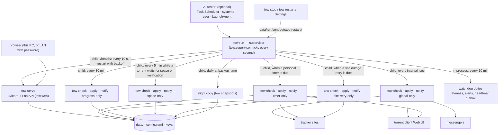

# Architecture

One page on how TOW is built: processes, modules, data, recovery and the security model. For running an install
see [PORTABLE.md](PORTABLE.md); for adding a client, messenger, site, language or page see
[EXTENDING.md](EXTENDING.md).

## Processes



- **`tow run`** is the single supervisor, not a single-process runtime. It holds `data/run/run.lock` (a second
  instance exits), starts every job as a child process, one job at a time, each with a time limit, and writes
  `data/run/status.json` only when something changes. A wall clock that jumps ahead of the monotonic one means the
  machine slept: overdue jobs run at once.
- **`tow serve`** is the web UI. If it exits, or holds its port without answering `/healthz` for a minute, the
  supervisor restarts it after a pause that doubles from 1 s to 5 min. It never outlives the supervisor: stopped
  on every way out of the loop, `--parent-pid` makes it stop when the supervisor is gone, a Windows job object
  and Linux `PR_SET_PDEATHSIG` end it with a killed supervisor. A server a dead supervisor left on the port (the
  pid in `status.json`, answering `/healthz` as this install or `-m tow serve` of this install) is stopped by
  the next `tow run`; nothing else on the port is ever touched.
- The schedule is the supervisor's own: checks every `interval_sec` after its last scheduled start
  (`data/run/schedule.json`), the night copy once per local day (a copy older than the latest slot is due; DST
  neither skips nor repeats a night). The watchdog duty only reports. Every job is one row of a table
  (`tow.supervisor.jobs`: arguments, time limit, cadence, saved key). The table order initializes a new schedule;
  afterwards the oldest overdue child runs first, with stable table-order ties. `last_child_attempt` is recorded
  before dispatch, including a failed spawn, so a long-running global check cannot starve the other children.
- A new revision whose selected files do not fit on the target drive (new bytes plus a 512 MiB margin, measured
  only on a drive this computer sees) is added stopped with its selection read back, and the topic keeps
  `waiting_space` (error `check.waiting_space`, class `disk`). While it waits no check downloads its `.torrent`
  again: every check, and the `space` pass the supervisor runs every 5 minutes only while a topic waits
  (`tow check --space-only`, client only), looks again and starts it once it fits, the start read back
  (`tow.check.space`). An earlier revision still running on the same files holds the start back, as it holds
  an add.
- A client that is still verifying existing files after an add does not make the check wait or fail
  (`tow.check.verification`). The topic keeps a `verification_pending` receipt that binds the selected file
  identities to one revision, client and owner settings; it is neither success nor an error, and Home says
  "Checking files". The next check, progress pass or `space` pass (which also runs while a receipt waits)
  finishes it from the client alone: no tracker request, re-add, stop, move or priority reset. A receipt the client
  contradicts (another owner, folder or selection, an error state) is blocked with a red error until the owner
  repairs it; a row's check may try it again. Allocation (qBittorrent) and a check waiting in Deluge's queue
  defer like a file check. A torrent the client does not list blocks only after two client answers at least
  600 s apart. A deferred add gets exactly one start, also when it is complete. Transmission hands over a paused
  add whose first check still runs after a 5 s grace (`INITIAL_CHECK_GRACE_SEC`; a shorter one finishes the add
  at once) (receipt phase `awaiting_initial_check`, saved as `unapplied_receipt`, never as
  `receipt`: 1.30.5-1.30.10 block it before any client change instead of reading it as an applied selection;
  versions before 1.30.5 know no receipts and would take a "once" topic for done while its torrent stays
  stopped, so `update.py` and the web update refuse a target below 1.30.5 while any topic has a
  `verification_pending`; likewise below 1.32.0 while a topic, or the item of a live undo, has a
  `content_ref`, which older versions read only as `content_token`) and applies the selection,
  stopped and read back, when it ends. The receipt keeps its first `since`; after 12 hours it shows a red
  `check.verification_overdue` (notified once) and is still finished later. Meanwhile the site is asked
  read-only on the normal schedule (revision probe or page magnet, never a `.torrent`), and a newer revision is
  kept as `observed_hash`. A blocked receipt of an unchanged revision downloads no `.torrent`; a failed start
  after a disk-space wait stays a blocked, repair-only handover. A queued row check passes the click's time
  (`readd_since`): a torrent removed after it is not added back.
- Personal tracker timers override the global cadence for their topic (`check_interval_min`,
  empty/null inherits; 1–10080 minutes). Changing the interval starts a new policy revision
  from save time; unrelated edits, manual checks and progress passes do not shift it.
  `schedule.json` holds revision-bound `timer_attempts` and the single dispatched `timer_batch`.
  The supervisor coalesces overdue topics into one child job, persists its scheduled start
  before spawning, and never launches without a durable reservation. Global jobs exclude
  custom topics; the timer child re-reads pause, once completion, deletion and policy revision
  after acquiring the shared check lock. Failure still consumes a scheduled attempt, not
  an every-tick retry. Old reservations cannot delay a changed policy; clock corrections use
  the same once-pinned anchors as other jobs. Global watchdog timestamps stay separate.
  Home shows clocks and digits only; tooltips distinguish waiting, checking, pause and unknown
  scheduler state. One shared visible-page poll refreshes custom deadlines, with server time
  and a monotonic browser clock. It stops polling while the page is hidden.
- Site retries (`tow.site_retries`, the `site_retry` job) check a topic again after a check left it with a
  transport-class error (class `tracker` or `cloudflare`): not after a ban, the daily limit or an HTTP sign-in
  refusal, and not for a paused or completed once topic or a paused site. `policies(state, cfg)` reads saved
  evidence only and binds each retry to a revision: a digest of the topic's link, hash, folder, client, selection,
  timer and last success plus the site's and the protection settings, so an edit starts a new budget. The first
  retry is due 300 s after the failed check (Cloudflare: `protection.min_interval_sec`, at least 1,800 s), each next
  one twice as late, capped at 7,200 s or the first delay if longer (`tow.topic_timers.retry_deadline`), never
  before the earliest mirror cooldown of the site ends, at most `MAX_SITE_RETRIES` (3) per revision. Topics of one
  site due within 30 s share one batch; a per-site jitter of up to 30 s spreads different sites. `schedule.json`
  holds `site_retry_attempts` and the dispatched `site_retry_batch`, written before the child starts: no unattended
  request without a durable reservation. The child (`tow check --site-retry-only`) re-reads the batch after taking
  the check lock (`site_retries.batch_ids`): deleted, paused, edited or recovered topics never run. `status.json`
  publishes the planned times, and a topic's panel on Home shows its own (`layout.site_retry_status`).
  A failed retry neither lengthens the streak after which a site outage is reported nor starts that message; a
  successful one ends the outage (and reports the recovery of a reported one). Spent retries are kept while
  the topic exists and expire a week after its last retry; a damaged record ends the budget. A partial run
  (retry, timer, one topic) never clears a failed scheduled check; a manual check of every topic may.
- Small diagnostic JSON records are bounded to 1 MiB and the store's nesting limit before
  use. Dates must be finite, non-negative and displayable. Reading does not rewrite or quarantine
  them; an unreadable backup/watchdog record is an observation error, not success or an outage.
  New diagnostic writes follow the same limits. These limits do not cap torrent state or history.
- Restore-point and night-copy cleanup are folder-scoped observations: pending, complete or unknown.
  Losing its record retains the watchdog's last confirmed result and raises a separate
  observation alert. Readability recovery does not confirm cleanup; a folder change cannot
  resolve an old folder's warning. Missing records on a fresh install are not failures.
  The archive or committed copy names (and their digest) bind a result to its inventory independently of
  wall-clock order. A new archive (for night copies: one signed by this install) without a new monitoring
  write makes the old result unknown; a copy deleted by hand or a foreign folder does not. Results recorded
  with the digest alone still need the exact inventory;
  an unbound legacy warning is retained, but unbound success needs a fresh observation.
  Readable legacy metadata is not a folder-access outage during migration. Once a bound
  result has been observed for a folder, losing its binding is an observation error.
  Night-copy creation, pruning and its monitoring write share the data lock; readers take
  the same lock to avoid comparing a committed copy with an unfinished monitoring write.
- A future scheduler fact after a backward clock correction is anchored once to its first
  observation, per fact source; repeated ticks do not move its deadline. Fresh job starts
  replace the corresponding anchor. Calendar backup slots remain wall-clock based; process
  timeouts still use the monotonic clock, which cannot supply dates across process restarts.
- Other processes never send signals: they write a request file into `data/run/control/` and the supervisor polls
  it. SIGTERM, SIGHUP (its terminal closed), Ctrl+C and, on Windows, Ctrl+Break stop it the same way.
- **Checks** hold `check_run_lock` for their whole run (one applying check at a time across processes) and take
  the data lock only to read and to commit, so the UI never waits for tracker or client network time.
  A web topic check (also a new topic's first one and the one after a sign-in) that cannot take this lock,
  or would pass applying work already waiting, joins a bounded FIFO (`tow.web.check_jobs`, run by
  `tow.web.check_actions`) instead of failing busy; previews wait in a lane of their own, so they never delay
  applying checks. Requests equal to a job that has not started share it; one equal to a running job gets one
  follow-up. Up to 32 jobs wait per lane, and only queued work can be cancelled. Each lane's consumer uses
  nonblocking attempts once a second, so scheduled/CLI checks keep the same lock contract; after 3900 s of
  waiting (a scheduled check's maximum plus cleanup) the job ends as not run. A running job is never timed out
  (that could overlap client writes); the page says since when it runs. Up to 64 transient results (100
  prioritized rows each, full totals) live for one hour in this web process at `/?check_result=<id>`, rendered
  from the job; a restart explicitly leaves the result unconfirmed and never replays a manual re-add. Waiting
  client verification, disk-space waits, skipped/unsaved results and real failures have distinct shared
  outcomes (`tow.check_outcomes`: one of new, same, pending, skipped or fail per row, for the web results, the
  run totals and `tow check` alike).
## Modules

| Package / module | Role |
|---|---|
| `tow.cli` | Every command (`run`, `serve`, `check`, `autostart`, `update`, `keys`, `export`…); `setup` lives in the launchers (`scripts/tow.cmd`, `scripts/tow`). The package itself is `main`: the language, the foreign-code check, one error boundary and the exit codes. `commands` is the one ordered command table, a `Command` (`command`) per command from `commands/service`, `data`, `security` and `checks`: its parser options, what it runs (importing what it needs only then), and how it runs (`layout`, `background`, `warn_open_folders`, `protects_folders`). `parser` builds argparse from the table, in the command's language; `render` is what a command prints. Only `tow.__main__` imports the package, and its modules never import the package itself. |
| `tow.supervisor` | `tow run`: the loop (`core`), the table of its jobs (`jobs`), timing with a fake-clock-testable schedule (`schedule`), its files (`layout`). What a personal timer or a site retry is due for comes from saved state: `tow.topic_timers` (intervals and retry deadlines) and `tow.site_retries` (which topics an outage retry may check). `tow.lifecycle` is the service as Settings sees it: status, autostart and a restart request with its marker. |
| `tow.web` | FastAPI app built by `create_app()`: one `APIRouter` per `routes_*.py`, the request middleware, templates. Everything outside the package is called through `tow.web.services`. `check_jobs` is the bounded FIFO of manual checks and their results, kept in this web process only; a scripted Check registers a client action id with its job before any work and gets a short acknowledgement, and `static/checks.js` follows every check this browser tab started (bounded polling of `/check/status` by job or action id, exactly one result message per job) and has the topic's Home row drawn again by `static/sync.js`'s row sync, the one writer of Home's rows (`POST /topics/rows` for the topics revision the page has, never over a row the owner works in). |
| `tow.check`, `check_steps`, `check_transaction` | A check run: fetch, decide, hand to the client, record — with a journal for the commit. The package exports `run_check` and the checks the web pages share; inside it `run` is the run, its commit and health record, `topic` one topic's check, `apply` what that check does in the client, `client_ops` hash identity, ownership, read-back and relocation, `reconcile` progress and the history commit, `space` the wait for disk space, `verification` the deferred client file verification, `notices` the messages, `rows` a topic's result row. `tow.check_outcomes` sorts a result row into one outcome. |
| `tow.progress` | The progress pass: a topic's torrent in its client and its files on disk, recorded in the download history. The package exports `reconcile_topic`, `progress_summary` and the disk confirmation (`filesystem_confirmation`, `safe_relative_path`, `CONFIRMATION_REUSE_SEC`); inside it `confirmation` is the disk confirmation, `labels` the events and their wording, `presence` the torrent gone from its client or back and superseded revisions, `expected` the selected files and the episodes expected (selection, episodes, file rules, aliases), `history` the history index and item identity, `reconcile` the pass itself, `summary` the completion summary. |
| `tow.trackers` | `generic.GenericHttpTracker` reads any configured site; `presets/<site>.py` adds what TOW knows about a particular site. `tow.mirrors` picks mirrors, cooldowns, redirects; a run's `MirrorSession` keeps pauses and observations across its requests (a preview saves nothing), and answers are recorded as operations on the saved state under the persistence lock (each with its request's start, so a late success cannot undo a newer failure). `observed` holds host health only; sign-in and daily-limit refusals are kept apart as `access`; pauses a clock jump left far ahead are clamped and saved once. |
| `tow.protection` | Optional site-access layer: pure bounded verdicts (`detect`), validated settings/contracts (`spec`), independent adapter discovery and bounded service HTTP (`providers`, `solvers`), ordered finite fallback (`chain`), encrypted origin/expiry/config-bound clearance and durable leases (`store`), absolute deadline over the existing pinned network backend (`transport`). `local_service` launches an owner-installed Windows module on demand (`runtime/services/flaresolverr/`, a pinned manifest), only from an applying provider call; it copies the standalone broker `tow.platform._local_service_worker` beside the manifest and starts it with the install's base Python. That broker imports nothing from TOW (standard library, Python 3.11 syntax), listens on loopback only, starts the native service lazily inside a Windows job object, serializes its calls and stops it after the manifest's idle time. Mirrors remain first; account sign-in stays in the native tracker. See [PROTECTION.md](PROTECTION.md). |
| `tow.clients` | Torrent adapters behind `TorrentClientAdapter`; qBittorrent, Transmission and Deluge all use the read-back contract of `managed.ManagedClient`; qBittorrent overrides its add, a full selection and the rollback's priority levels. The helper modules (`HELPERS`): `spec` (the contract and discovery), `factory` (the configured clients), `managed`, `files`, `address` (a client's Web UI address, shared by Transmission, Deluge and the web's reachability check), and `view` (the settings cards, as `notifiers.view` makes the messengers'). |
| `tow.adopt` | Adopt into TOW: on the owner's request only, the `tow` mark on a torrent already in the client (added by hand or by another program), read back and logged; nothing else about the torrent changes. |
| `tow.notifiers` | One module per messenger behind the `Notifier` protocol; `outbox` is the per-recipient delivery queue; `view` the settings cards and the header's status; `tow.delivery` groups, delays and digests. |
| `tow.plugins` | The one scan that finds client and messenger modules (`clients.spec`, `notifiers.registry`): every module but the family's `HELPERS` and `_` names; a broken one is named in the family's `SKIPPED` and logged, never fatal. |
| `tow.selection`, `tow.episodes`, `tow.torrent` | Which files to download; episode parsing; bencode and info-hash. |
| `tow.content` | Encrypted, bounded metadata preparation snapshots; literal file identities for graphical selection, without transfer-task mutations or media retrieval. Explicit native magnet preview is separate from the mutating add fallback and from dry-run. A local `.torrent` only previews: it never becomes a new topic's first revision or its saved metadata. |
| `tow.torrent_cache` | One encrypted obtained `.torrent` per live topic URL, bounded to 256 MiB and 2,048 records; shared URLs retain one copy. Reopening contents spends no tracker quota. Normal checks do not use it as revision evidence; a changed magnet invalidates the old copy. The last topic's removal deletes metadata, never client torrents or media. |
| `tow.store`, `tow.storage`, `tow.store_transaction`, `tow.site_journal`, `tow.journal` | State, history, encrypted secrets; the data lock; journaled multi-file writes (`tow.journal`: the folder of copies that the check and store transactions share). `tow.store` stays one file: it keeps the state and the history (load, save, validation, the parsed cache) and the literal `STATE_SCHEMA_VERSION`, which the updater reads from its text. Everything else the stores are built on lives in the `tow.storage` package and is re-exported by `tow.store` (`__all__`), where the rest of TOW imports it: `errors` (the errors several storage modules raise), `jsonio` (the JSON codec: finite numbers, the nesting limit, the exact bytes written), `atomic` (bounded reads, atomic writes, the count of files written), `locks` (the data lock `persistence_lock`, the `RECOVERY_STEPS` it runs first, `check_run_lock`, the stale temporaries of killed writes), `keys` (the master key: where it comes from, its Fernet, the secrets derived from it, a new key file), `secrets` (the encrypted secrets and the settings undo in their Fernet envelopes, and the two key operations that must look at them first: `generate_master_key`, `adopt_master_key`), `folders` (the install root, `keys/` and `data/` private to this account). A test replaces a name in the module that reads it. |
| `tow.undo` | One undo engine: a record per change, restored through one transaction. |
| `tow.volumes` | The owner's "same disk - accept": binds a folder off its recorded volume to the one it is on now, only with a file of the topic (or a copy of TOW's) found there. |
| `tow.access`, `tow.auth` | Password, sessions, this-computer-only actions. |
| `tow.snapshots`, `tow.restore_points` | Night copies, restore points. The `tow.snapshots` package exports what the CLI, the web, the supervisor and the watchdog use; inside it `errors` is `SnapshotError`, `members` what a copy holds and where each member goes, `manifest` the signed MANIFEST and its limits, `location` the copies folder and its copies, `record` the status record and the cleanup it observed, `verify` the read-back, `create` making, pruning and removing copies, `restore` the all-or-nothing restore with its safety copies, rollback and `recover_interrupted_restore` (`tow.storage.locks.RECOVERY_STEPS` reaches it through the package). |
| `tow.bundle` | The `.towx` file: export, import, the import checkpoint and its rollback. Inside: `errors` (`ExportImportError`), `io` (the format name, the size limit, JSON bytes, checksums, bounded reads, atomic writes), `secret_scan` (no credential-named field outside the encrypted secrets), `schema` (what each member may contain: the bundle's own checks, kept apart from the store's), `crypto` (the passphrase key and the Fernet envelope), `archive` (the zip, its manifest, reading a bundle back), `path_maps` (`--path-map OLD=NEW` for the imported folders), `checkpoint` (the import checkpoint: its transaction marker, the recovery of an interrupted import, rollback, pruning), `export` and `importer` (the two operations). The package itself only re-exports the public names (`__all__`); a test replaces a name in the module that reads it. |
| `tow.releases`, `tow.web_update`, `tow.update_worker` | Cached read-only release discovery; serialized web launch with a verified archive; an isolated standard-library worker outside `app/`, an exiting-parent handoff (local Windows broker for inherited outer jobs), independence checks before stopping TOW, durable progress and the existing updater's rollback. |
| `tow.watchdog`, `tow.pulse` | Is TOW up and on schedule; why it was silent (from facts the OS keeps). |
| `tow.issues` | What needs the owner now, from saved state: one module per kind in `issues.kinds` (found by `tow.plugins.scan`), each with `KIND`, `ORDER` and `collect(snapshot)`; `collect` orders the issues worst first and merges one problem seen twice (a site's sign-ins, with their count). An `Issue` has a severity (a `tow.status` tone), a catalog message, a `Target` (the page and the element that show it) and a `Fix` (the control that resolves it). Pure: the caller passes the `Snapshot` (state, config, the next scheduled check, the lost-data note); it imports neither the web nor the CLI (`tests/test_layers.py`). Home's "Needs attention" (`tow.web.views.attention_view` turns targets into links) and `tow status` show the same list. |
| `tow.autostart` | Task Scheduler, systemd user unit, LaunchAgent — each change read back. |
| `tow.platform` | Every OS difference (boot time, sleep, processes, browsers, protected folders). |
| `tow.paths` | Every location, derived from one install root. |
| `tow.i18n`, `tow.errors` | Language catalogs; typed errors (`TowError(key, **params)`) rendered in the reader's language. |
| `tow.config`, `tow.records`, `tow.jsonish`, `tow.yaml_guard`, `tow.diagnostic_json` | The config file, its defaults, port and interval; the typed records of `state.json` and `download_history.json`; helpers for loosely typed stored data; YAML bounded before construction; bounded read-only decoding of small service records (supervisor status, watchdog, backup and restart records). |
| `tow.http`, `tow.net_guard`, `tow.net_errors` | Site HTTP: response size and time limits, page decoding, Cloudflare detection, `Retry-After`; outbound connections pinned to a checked public DNS answer; network errors in the owner's words. |
| `tow.guess`, `tow.title`, `tow.topic_form`, `tow.browser_auth` | New site settings from a pasted topic link; a topic's title from its link or page; the topic form's fields, selection rule and the record it builds; browser sign-in in a temporary profile under `data/browser-auth/`. |
| `tow.log`, `tow.events`, `tow.notify`, `tow.download_history` | The event log (`data/tow.jsonl`: write, rotation, scrubbing, labels, History search; `append_event` returns the new event's id or None, `log_event` stays the Boolean every caller uses); event and operation ids; the notifications a check collects and their wording; how long the download history keeps old entries. |
| `tow.messages_feed` | Recent messages, one list for every signed-in device: the event -> message matrix (`MATRIX`, typed severity, recoveries, repeated failures of one site as one entry), a background reader of the retained log that never takes the log or the data lock (complete lines only; a file keeps its identity, the hash of its first line, through rotation), opaque cursors in append order (file, offset, event id; never a time), the bounded feed (50 entries of 7 days, expiring without a new event), the shared read/cleared markers in `data/ui.json` (schema 1, cursor metadata only, read-modify-write under its own lock `data/.ui.lock`, markers only move forward) and an update's result logged once per job from its job record. `tow.web.messages` renders it per language (`feed_payload`, `messages_revision()` for the sync poll), `tow.web.routes_messages` serves `GET /messages.json` (ETag, 304, `private, no-cache`) and `POST /messages/read`, `/messages/clear` (409 for a cursor no longer shown, 503 when the markers cannot be saved). |
| `tow.scrub` | The words any signed-in device may read: one policy for Recent messages and every page or answer a network device gets. A link keeps only its host, a folder or file path goes; a message's values that name a folder or a file are "…" before its words are formatted. The PC running TOW keeps every word. |
| `tow.clock`, `tow.bind`, `tow.ratelimit` | Local time and displayed timestamps; the web server's bind address and the request-origin check; throttling of wrong network passwords. |
| `tow.locations`, `tow.backup_actions`, `tow.backup_retention` | Where each kind of backup goes; Check, Restore and Delete bound to the selected copy; which night copies retention keeps. |
| `tow.supervisor` helpers | `_os` (the children's Python, starting an owned child with its output in a file, the port check), `parent` (`tow serve --parent-pid`: the server ends with the supervisor), `starter` (`tow start`). |
| `tow.platform` backends | `windows` and `posix` (Linux and macOS), with the helpers they share in `_common`. |
| `tow.web` helpers | `middleware` (who may ask, the headers, recovery before dispatch), `_context` (one request's config, state and secrets, each read once), `templating` and `text` (templates and texts in the page's language), `messages` (a message after an action: its record - kind, subject, text, id, undo stamp -, the subject a topic, site or client route names before it changes anything, the "{subject} — {result}" wording and the redirect that shows it once; `static/messages.js` shows it once, keeps it under "This tab" in the header's Recent messages, and draws the install's shared list from `GET /messages.json`), `site_form`, `site_actions` and `site_store` (what the site forms accept, do and write), `topic_actions` (the topic forms on Home), `edit_base` (an edit form's base - the values it showed, passwords as opaque tokens - and the three-way merge of its save with what is saved now; a conflict's draft in memory) with `topic_merge`, `site_merge` and `settings_merge` (each form's groups of fields and values). `sync` with `tow.sync_sources` (one state on every open page: a shared sample of the install's files taken at most once a second, and at once after this process's own write, read whole and hashed without a lock, and per-area revisions - SHA-256 of what pages show, recomputed at clock deadlines - that `GET /sync.json` and `/topics/rows` publish on a read-only request path; `/sync.json`, `/topics/rows`, `/page/fragments` and `/messages*` share one token bucket per network session or per tab of this computer, `web.rate_burst`/`web.rate_per_sec` read from the sample, answering 429 with `Retry-After` past it); `static/sync.js` follows it on every signed-in page (one request every 5 s while visible, none hidden, at once when shown, 5-60 s backoff) and puts each area on the page: Home's rows in revision-bound batches (a row in use waits), the header, the checks, the Undo, the theme, and a reload for another language or version only when nothing is being typed. `page_sync` (Sites, Settings and History while open: a page's fragments - a site's row, a Settings section, the Settings alerts above them (`settings-alerts`) - are marked in its template, their digests are its revision, and `GET /page/fragments` hands those of exactly that revision; History's revision is the digest of the window its filters draw (its newest lines, keyed by event), kept for the fragment answer, so a log line it does not show changes nothing); `static/pages.js` puts in only what differs, never over a form in use, with mount and unmount hooks for the scripts of what it replaces. |

Three places speak about problems, each for its own moment:

- `tow.doctor` probes on request (the Diagnostics page, `tow doctor`): it asks the client and the sites now.
- `tow.watchdog` runs in `tow run` every 10 minutes and alerts the messengers when something changes (TOW down,
  checks late, a failed night copy, a lost data folder).
- `tow.issues` says what needs the owner now, from saved state only, asking nothing and sending nothing: Home's
  "Needs attention" and `tow status`. Where a rule is shared, it lives once: the lateness of scheduled checks is
  `tow.issues.kinds.check_stale.late`, which the watchdog uses too.

Torrent metadata rejects real file/directory conflicts after portable path normalization,
as well as duplicate file paths. Padding entries remain virtual. Sorting normalized
paths with a trailing separator detects ancestors independently of input order in
O(n log n); a name like `A-` cannot hide the conflict between `A` and `A/B`.
TOW cannot safely map client-side automatic renames back to a saved selection, so it
refuses conflicting metadata before preparing a tree or changing client tasks.

Rule previews use the applying check's season parser and selection engine. They read saved
tracker titles only for the same topic source and client; otherwise the current form title
provides context. Future watch ranges are waiting, not failures, while once ranges remain
strict. Preview refreshes do not fetch trackers or mutate clients, and stale title/lifecycle
responses are discarded. An applying check still obtains the current tracker title independently.

Episode rules build a per-call index of available numbers and season maxima. Repeated or
overlapping requests are matched once per distinct label; waiting checks use those maxima,
not another scan of all files. The original first ten diagnostic labels, including repeats,
remain in input order. Subtitle season context still contributes to ambiguity. The index is
not a persistent cache and does not change saved policies, file priorities or history identities.

File masks match the full relative path or basename (a flat path is tried once) through
`fnmatch.translate`, prepared once per distinct case-folded rule per call; only those exact
regexes accept a path. Each rule is grouped under its rarest fixed text (text outside wildcards, `[?]` and
other one-character classes included), so a shared title cannot make every rule a
candidate. One prefix-factored lookahead union finds the longest such text at each path
position (shorter ones there are its prefixes), and only the groups found are compiled and
tried. Rules without fixed text form one exact union. Up to eight texts every guarded rule
needs, and up to eight unions of each rule's n-th class (membership decided by `fnmatch`,
1,024 cached characters per filter), only reject. A call compiles at most its distinct rules
plus ten regexes, never a Python dispatch per file and mask.

## Data layout

```text
<install>/
  app/                     the code: a git clone at a release tag, or a release archive
  config.yaml              settings and sites (no secrets)
  data/
    state.json             topics, their status, undo record, pending notifications
    download_history.json  files of every revision
    secrets.enc            passwords, tokens, cookies, password record — Fernet, master key
    secrets-undo.enc       the secrets before the last undoable change
    protection.enc         optional encrypted site-access cache and provider cooldown leases (bounded)
    sessions.json          revoked network sessions and the "Sign out everywhere" counter
    ui.json                how far Recent messages are read and cleared (shared by every device; in no copy)
    tow.jsonl              structured events — rotated
    restore-points/        restore points (.towx)
    logs/                  process and job output (including serve.log) — rotated
    run/                   supervisor lock, pid, status, schedule (with timer and site-retry reservations), control/
    torrent-metadata/      encrypted obtained torrent files for live topics (bounded)
    tmp/                   private temp folder (TOW's own leftovers cleaned after a day)
    browser-auth/          temporary browser profiles for site sign-in
  keys/master.key          the master key — outside data/, so no copy of data/ carries it
  backup/                  night/ copies, update-…-before-… snapshots
  runtime/                 Python and uv cache of this install
    web-update/            durable job record, copied worker/updater and bounded UI log access
    services/flaresolverr/ optional owner-installed on-demand site-access module: manifest, program, copied broker
```

`tow.paths.root()` finds the install: `TOW_ROOT`; else the parent of an `app` code folder that has `config.yaml`
or `data/` next to it; else the development checkout itself. A `TOW_ROOT` that names another folder than the install
whose code runs (a variable left from a move) is ignored, with a note, so TOW never starts empty in the old place.
An install whose `.venv` runs another folder's code (a copy, while the original is still there) is refused before
anything is written (`tow.paths.foreign_code()`, exit code 3): run setup in the copy first. Details:
[PORTABLE.md](PORTABLE.md#1-one-folder). Nothing is written outside the install except the autostart entry, and
that only on request.

Download folder history is a convenience, not an access allowlist: every authorized owner device
may enter a new absolute client folder. Syntax, protected-system-folder and optional UNC checks
still run before a topic is saved or moved. The legacy `allowed_save_roots` config field is accepted
for old config/import compatibility but no longer restricts the owner. `state.save_roots` keeps up to
ten full recently used paths, newest first; older ancestor-only entries remain usable without a data
rewrite. The editable folder picker shows this entire list on its arrow, independent of typed text.

The detached update worker holds its per-job OS lease throughout the installation. Its initial acquisition
retries nonblocking calls for at most one second on a monotonic clock, so a brief status probe does not abort
the handoff. After acquisition it re-reads the unchanged queued job and checks its 30-second handoff expiry
again before starting. A busy lease never grants ownership or permission to overwrite another worker's result.
The copied Python 3.11 worker enforces the job journal's 64 KiB, finite-number and nesting
limits independently of the replaceable app. Even a handoff refusal takes the lease and
re-reads the unchanged queued reservation before publishing a result. Damaged records or
leases are retained, not reconstructed or turned into terminal results without ownership.
Journal writes validate before an exclusive temporary file, fsync and atomic replace;
current-state schema preflight uses strict JSON without the small job-size cap.
Every worker entry binds its journal and nonce to the copied script's own job folder;
relays use the derived path, not the supplied filename, after checking path equivalence.
The trusted producer resolves the install path; the worker's supplied-name check is lexical
and does not inspect a foreign path. Install-root aliases therefore remain supported.
The app validates displayable job timestamps for every phase before status, log or launch
decisions; unreadable dates fail closed without modifying the journal.

## Recovery

Backup lists are compact, closed by default, and offer Check, Restore and Delete for
both kinds. Deletion has a dated server confirmation (also without JavaScript) and
is bound to the copy's location and regular-file metadata. A changed selection is
refused. Only the selected copy is removed and absence is read back; it is not undoable.
Signed night-copy metadata and the owned tree prevent deletion of foreign files or links.
Explicit manual deletion can remove a damaged ordinary archive without decrypting it.
Deleting one copy rebinds a known cleanup observation without clearing previous warnings.

New night-copy policies default to `backup_days: 7`. Existing explicit `backup_keep`
count policies remain supported until days are saved. Retention follows a verified new
copy; that copy is always protected. Age uses signed creation time relative to the new
copy, and future-dated copies are kept after a clock correction. The three newest earlier copies are kept
whatever their age, so a gap longer than the retention does not leave the new copy alone. An optional
`backup_max_mib` can shorten history, but never removes the new copy or foreign data.
Insufficient room for the full new copy plus a reserve refuses creation before pruning.
`backup_enabled: false` removes scheduled backup jobs and stale-copy alerts, not
manual actions or cleanup monitoring. Already running jobs finish normally.

Night-copy creation reads regular sources in bounded blocks and hashes the same bytes
it writes to exclusive prepared files. Opened descriptors, complete byte counts and
modification times are checked; a disappearing or changing source cannot publish a
successful copy. The event-log lock prevents concurrent append/rotation while copied.
Payload files and the bounded signed manifest are flushed/fsynced before the directory
is published. Destination read-back and semantic validation still precede retention;
this does not bound semantic JSON parsing or applied-restore plans, or change copy formats.

Night-copy verification and preview first stream-check every member's signed hash, then
read and re-check one semantic store at a time before parsing it. Opaque logs and nested
archives are not retained. Regular-file and opened-descriptor checks refuse special files,
links and inconsistent sizes. An applied restore requires a signed manifest and retains its
checked bytes for the transaction; it never re-reads an unchecked source to write live data.
This reduces verification memory, not the full applied-restore transaction's memory footprint.

Night-restore metadata uses separate byte budgets: the marker is limited to 64 KiB,
the journal to 4 MiB (with headroom for every member of a supported 1 MiB manifest).
Opened regular records are size-checked before reading and strict JSON decoding; changed
or unreadable records are preserved and never treated as successful recovery. Marker
discovery uses lstat, so dangling links do not disappear from recovery checks. Producers
preflight every final journal phase before publishing the marker; legacy rollback checks
its final record before any live write. Cleanup proof reads obey the same metadata limits.
These bounds do not limit state/history payloads or remove the full restore's memory plans.

Every multi-file write is journaled; whichever TOW process next takes the data lock (`persistence_lock`) runs the
registered recovery hooks first, so no process ever reads half-written stores. The check and store transactions
share one journal (`tow.journal`): copies of the stores and a marker with their SHA-256, every copy checked before
the first store is put back; each keeps its own folder and manifest format. The import checkpoint and the night
restore keep their own (folders kept after the write, a marker outside the folder).

A night copy carries the event log for the record, but a restore never puts it back:
History keeps what happened after the copy was made. Event-log writes therefore take only
the log lock and never wait for the data lock. Only the rollback of a restore journaled by
1.23.11 or earlier, which did replace the log, holds the log lock while it puts it back.
Diagnostic logging must not turn an already-confirmed client operation into a reported
client failure.

| Journal | Protects | On a crash |
|---|---|---|
| Check transaction (`data/.tow-check-transaction/`) | `state.json` + `download_history.json` of one check | rolled back or completed |
| Store transaction (`tow.store_transaction`, `tow.site_journal`) | `config.yaml` + `state.json` + secrets + undo snapshot (site edits, settings, undo) | all four back as before |
| Import checkpoint (`tow.bundle.checkpoint`) | `.towx` imports | rolled back |
| Night restore marker (`.tow-night-restore.json`) | restoring a night copy | previous data put back |

Single files are written atomically (temp file, fsync, rename). `state.json` carries a data version: an older TOW
refuses newer data instead of damaging it. Notifications are staged in the same write as the check result and
moved to the outbox in one locked write, so a stop between them loses nothing.

## Security model

| Concern | How |
|---|---|
| Who may ask | A loopback peer (this computer) needs no password. Other peers are refused unless network access is on, and then need a session. Peers with a public internet address are always refused, whatever `Host` says. The peer is the connection's address: `X-Forwarded-For` / `X-Forwarded-Proto` are ignored (uvicorn `proxy_headers=False`). |
| Host header | From this computer only `localhost` and loopback IP literals (`127.0.0.1`, `[::1]`): the computer's own name can be answered on the network through LLMNR or mDNS. From other devices `localhost`, non-public IP literals, this computer's name (`<name>`, `<name>.local`) and the configured bind name. Anything else is 403 "untrusted host" (DNS rebinding). |
| Request bodies | A write states its size: a chunked body, or an upload without `Content-Length`, is 411; a form over 512 KiB is 413 (the `.towx` import and the `.torrent` preview have their own limits). `POST /login` takes only `application/x-www-form-urlencoded` (415). Checked from the headers, before Starlette parses a form. |
| Password | PBKDF2-SHA256, 600 000 iterations, in the encrypted secrets; at least 8 characters; optional reminder, never containing the password. Wrong passwords lock a device out after 5 in 10 minutes (30 s, doubling up to 1 h) and every device after 30 from all of them (up to 15 min). |
| Sessions | `tow_session` cookie: HttpOnly, SameSite=Lax, 90 days, signed with a key derived from the password record (a new password signs every device out); revocations survive restarts. |
| CSRF | Every POST/PUT/PATCH/DELETE must carry an `Origin` equal to the request's own origin. |
| Page | CSP `default-src 'self'` (no inline script or style, no framing), `X-Frame-Options: DENY`, `nosniff`, `Referrer-Policy: same-origin`. Flash messages travel as a server-side token, never as text in the URL. |
| Local-only actions | Turning network access on or off and the first-start page: this computer only. |
| Secrets at rest | `secrets.enc` (Fernet). The master key lives in `keys/`, never in data copies; night copies are signed with a key derived from it. Every start closes the install root (the code TOW runs), `keys/` and `data/` to other accounts (Windows: this account, SYSTEM and Administrators, nothing inherited; POSIX 0700, the root only when world-writable) and warns when it cannot; `tow doctor` reports it. |
| Outbound requests | Site addresses entered in the web UI that resolve to private, loopback or CGNAT ranges are refused (SSRF); download redirects may not leave the site's configured hosts. |
| Folders | Downloads and backups may not go into system or profile folders on any OS (8.3 names, trailing dots and links included). |
| Torrents | TOW only changes torrents tagged `tow`; a client add counts only after read-back. A torrent it did not add gets the tag only when the owner adopts it (`tow.adopt`). |

Not covered: a reverse proxy on the same host makes every request look local, and anyone with access to the
user account (or the `keys/` folder) can read the secrets. See [SECURITY.md](../SECURITY.md).

## Code API: paths and platform

Stable names other modules build on.

`tow.paths` — nothing else in TOW derives a path on its own:

| Function | Path | Created by the call |
|---|---|---|
| `root()` | the install root | no |
| `repo_root()` | the code folder (`<install>/app`, or the dev checkout) | no |
| `data_dir()` | `TOW_HOME`, else `<root>/data` | yes |
| `config_path()` | `TOW_CONFIG`, else `<root>/config.yaml` (must exist) | no |
| `keys_dir()` / `key_file()` | `<root>/keys` / `<root>/keys/master.key` | no |
| `explicit_key_file()` | `TOW_MASTER_KEY_FILE`: absolute as given, relative inside `<data>` (else refused) | no |
| `user_home()` | the owner's home folder: only the autostart entry is written there, on request | no |
| `ui_state_path(create=False)` | `<data>/ui.json` (Recent messages' shared markers) | only with `create=True` |
| `tmp_dir()` | `<data>/tmp` | yes |
| `logs_dir()` | `<data>/logs` | yes |
| `run_dir()` | `<data>/run` (pid, lock, `control/`) | yes |
| `backup_root()` | `<root>/backup` | no |
| `runtime_dir()` | `<root>/runtime` (`python/`, `cache/`, `bin/uv`) | no |
| `use_private_temp()` | points `tempfile` and `TMP`/`TEMP`/`TMPDIR` at `tmp_dir()` | yes |

`tow.platform` — everything that differs between Windows, Linux and macOS:

- `current()` returns this machine's backend; `use(backend)` (a context manager) and `set_backend(backend | None)`
  inject another one in tests; `backend_for("windows" | "linux" | "macos")` builds one by name.
- A backend has `name` and:
  - `boot_time(now=None)`, `asleep_seconds()`, `logon_time()` — unix times or seconds, `None` when unknown;
  - `shutdown_reasons(since, until)` — shutdown records, oldest first, `[]` when unknown;
  - `spawn_detached(argv, *, hidden=True, log_path=None, cwd=None, env=None, require_breakaway=False)` → pid
    (outlives the parent; no console window on Windows; own session on POSIX);
  - `publish_exclusive(source, destination)` — publish complete prepared bytes without replacing an occupied
    name (Windows rename; POSIX hard link, else renameat2/renamex_np that never replace; unsupported destinations
    fail closed);
  - `popen_options(*, new_group=False, hidden=True)` — the same flags for a `subprocess.Popen` the caller keeps;
  - `process_alive(pid)`, `terminate(pid, timeout=10.0)` (the whole tree or process group) → bool;
  - `process_command(pid)` → command line or `None` when unknown; read-only, used to identify pre-lease update workers;
  - `bind_children()` → bool: Windows puts this process into a kill-on-close job object its later children
    inherit (they end with it; `spawn_detached` still breaks away); `False` elsewhere;
  - `die_with_parent(parent_pid)` → bool: Linux asks for SIGTERM when the parent ends (`PR_SET_PDEATHSIG`);
    `False` elsewhere;
  - `port_owner(port)` → `{pid, cmd, parent, parent_cmd}` or `None`;
  - `browser_executables()` — Chromium-family browsers found, best first;
  - `bring_to_front(pid)` — Windows only; no-op elsewhere;
  - `protected_folders()` — folders a download or backup must never go to;
  - `folder_shared(path)` → bool | None: other accounts of this computer may open it;
    `root_shared(path)` → bool | None: the same question for the install root (Linux, macOS:
    every account may write in it); `make_private(path, created=False)` → bool: only this
    account (Windows: and SYSTEM, Administrators) keeps access, only for a folder this account
    owns or this process has just created, read back; for `tow permissions` (`tow.permissions`):
    `elevated()`, `folder_owner(path)`, `shared_for(path, account)`, `account_name` / `account_of`,
    `personal_account(account)` and `hand_over(path, account)` (owner and permissions of one
    folder, administrator only, read back);
  - `open_url(url)` → bool;
  - `ui_language()` → the system's language tag (`ru-RU`) for commands typed in a terminal, `None` when unknown.
- `private_folders(folders, repair=True)` — the folders that other accounts can still open,
  after making ours private; `private_root(root, repair=True)` — whether other accounts can
  still change the install root; both never raise (start-up and `tow doctor`).
- `is_plain_file(info)`, `is_plain_dir(info)`, `is_link_like(info)` — an `lstat` result that is a
  regular file or folder and no link, or one that is a link or a Windows reparse point (junction,
  mount point). Every such check goes through them; only `update_worker.py` and
  `scripts/update.py` keep their own copy (standard library only). `plain_kind(path,
  missing_ok=True)` asks the path itself: `"file"`, `"dir"`, `"other"` (a link, junction or
  special file) or `None` when nothing is there; each caller keeps its own error for each answer.
- `user_id()`, `user_name()` — this account's numeric id (POSIX; 0 on Windows) and login name.
